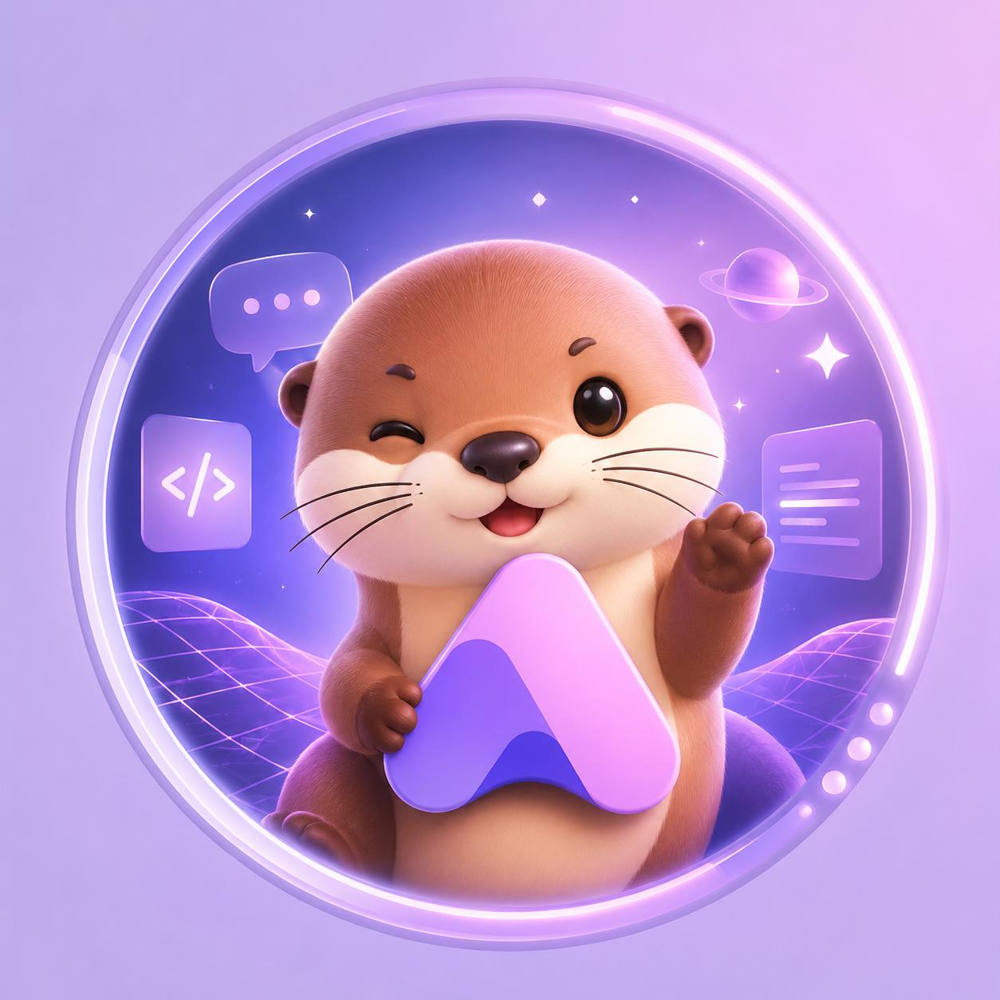

<div align="center">
  
</div>

<h1 align="center">Bienvenue chez Pimolu</h1>

<p align="center">
  <strong>Un design system qui tient ses promesses.</strong><br />
  Des composants React accessibles, une source de vérité unique pour le visuel,<br />
  et des thèmes que l’on change à l’exécution — sans framework de style à apprendre.
</p>

<p align="center">
  <sub><em>Pimolu UI — an open-source design system that keeps its promises: tokens, themes and accessible React components.</em></sub>
</p>

<p align="center">
  <a href="https://pimolu.com">Site</a> ·
  <a href="https://pimolu.com/docs">Documentation</a> ·
  <a href="https://pimolu.com/components">Composants</a> ·
  <a href="https://pimolu.com/blocks">Blocks</a> ·
  <a href="https://pimolu.com/showcase">Showcase</a> ·
  <a href="https://www.npmjs.com/org/pimolu">npm</a> ·
  <a href="https://discord.gg/b2UDyvKAcH">Discord</a>
</p>

<p align="center">
  <a href="https://www.npmjs.com/package/@pimolu/react"></a>
  
  
  
</p>

---

## Notre conviction

Les interfaces finissent par dériver. Une couleur ajustée ici, un rayon modifié là, et quelques mois plus tard plus aucun écran ne semble appartenir au même produit.

Pimolu traite cette dérive comme le premier problème à résoudre. Chaque décision visuelle vit derrière un **design token** : la cohérence devient le comportement par défaut plutôt qu’un effort permanent. Les thèmes et les styles s’appliquent par attributs, jamais par du code conditionnel — on dessine l’interface une fois, puis on l’habille selon le produit, aujourd’hui comme demain.

Et parce qu’une fondation doit rester lisible, il n’y a ni runtime CSS-in-JS, ni framework de classes utilitaires, ni magie de build. Juste du CSS : des classes `pimolu-*` et des variables `--pimolu-*` que vous pouvez lire, surcharger et quitter.

## Ce que ça change

| Principe | Ce que vous obtenez |
| --- | --- |
| **Une seule source de vérité** | Les valeurs sont écrites une fois comme design tokens, puis compilées pour le web et JavaScript. Un changement se propage au lieu d’être répété. |
| **Des thèmes sans réécriture** | Clair, sombre et système, plus sept presets visuels, s’activent à l’exécution par attribut. Aucun composant n’est touché. |
| **L’accessibilité incluse** | Navigation clavier, focus visible, états occupé et désactivé, libellés pour lecteurs d’écran et respect de `prefers-reduced-motion`. |
| **Aucun framework à apprendre** | Du CSS simple et prévisible, facile à surcharger, sans verrou technique. |
| **Typé de bout en bout** | TypeScript strict sur les composants et les API publiques : les erreurs arrivent avant l’exécution. |

Combinez librement un thème (clair, sombre, système) avec un preset : `default`, `monochrome`, `cartoon`, `glass`, `luxury`, `neo-brutalism` ou `adaptive`. La densité, le rayon et la couleur de marque se règlent séparément, sans toucher aux composants.

## Démarrer

```bash
npm install @pimolu/react@beta @pimolu/web-styles@beta
```

```tsx
import { Button, PimoluProvider } from "@pimolu/react";
import "@pimolu/web-styles/styles.css";

export function App() {
  return (
    <PimoluProvider theme="dark" stylePreset="glass">
      <Button>Commencer</Button>
    </PimoluProvider>
  );
}
```

Importez la feuille de styles une fois à l’entrée de votre application, enveloppez l’interface dans `PimoluProvider`, et changez de thème ou de preset sans modifier un seul composant. Tailwind CSS reste optionnel.

## Explorer

| Ressource | Ce que vous y trouverez |
| --- | --- |
| [**pimolu.com**](https://pimolu.com) | Le site, la démo interactive et la vision du produit. |
| [**Documentation**](https://pimolu.com/docs) | Installation, theming, API et guides pratiques. |
| [**Composants**](https://pimolu.com/components) | Le catalogue complet, avec des exemples vivants. |
| [**Blocks**](https://pimolu.com/blocks) | Des compositions prêtes à l’emploi pour aller plus vite. |
| [**Showcase**](https://pimolu.com/showcase) | Des produits construits avec Pimolu UI. |
| [**Releases**](https://pimolu.com/releases) | Notes de version et évolutions du système. |
| [**npm**](https://www.npmjs.com/org/pimolu) | Les paquets publiés de l’écosystème. |

## Les dépôts

| Dépôt | Rôle |
| --- | --- |
| [**ui**](https://github.com/pimoludev/ui) | Le design system : tokens, thèmes, composants React, playground et site de documentation. |
| [**react-vite-starter**](https://github.com/pimoludev/react-vite-starter) | Un starter React minimal et autonome avec Vite, TypeScript, Tailwind et les paquets Pimolu publiés. |
| [**nextjs-starter**](https://github.com/pimoludev/nextjs-starter) | Le point de départ équivalent pour une application Next.js. |
| [**dashboard-starter**](https://github.com/pimoludev/dashboard-starter) | Un template de tableau de bord pour démarrer une application de gestion. |
| [**saas-landing**](https://github.com/pimoludev/saas-landing) | Un template de landing page pour un produit SaaS. |
| [**pimolu-headset**](https://github.com/pimoludev/pimolu-headset) | Une boutique de démonstration complète, construite avec Pimolu UI — [voir en ligne](https://pimolu-headset.pimolu.com/). |
| [**cli**](https://github.com/pimoludev/cli) | L’outil en ligne de commande de l’écosystème Pimolu. |
| [**.github**](https://github.com/pimoludev/.github) | Le profil de l’organisation et ses visuels. |

## La mascotte

<table>
  <tr>
    <td width="230" align="center" valign="middle">
      
    </td>
    <td valign="middle">
      <p>Pimolu, c’est aussi une loutre. Curieuse, méticuleuse, jamais à court d’idées — et un peu bavarde quand il s’agit de design.</p>
      <p>Elle nous rappelle ce que nous cherchons dans chaque interface : de la précision, de la personnalité, et le plaisir de faire bien les choses.</p>
    </td>
  </tr>
</table>

## Construire avec nous

Pimolu se développe ouvertement. Une question, une idée, un bug ? Ouvrez une [issue](https://github.com/pimoludev/ui/issues) sur le dépôt concerné ou rejoignez le [Discord](https://discord.gg/b2UDyvKAcH).

Les contributions sont bienvenues. Pour les changements de fond, parlons-en d’abord dans une issue afin de garder le système cohérent.

---

<p align="center">
  <sub>Les dépôts publics de Pimolu sont publiés sous licence MIT. © 2026 pimoludev.</sub><br />
  <sub>Fait avec Pimolu UI · <a href="https://pimolu.com">pimolu.com</a></sub>
</p>
